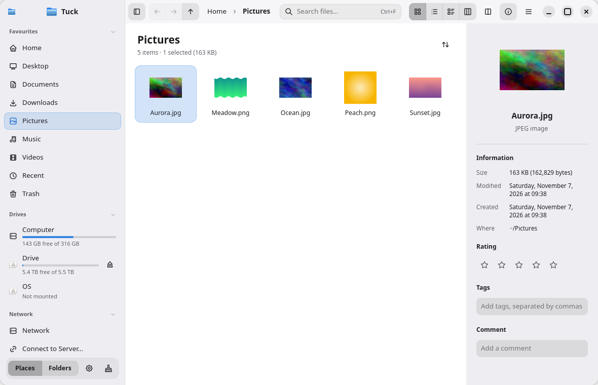
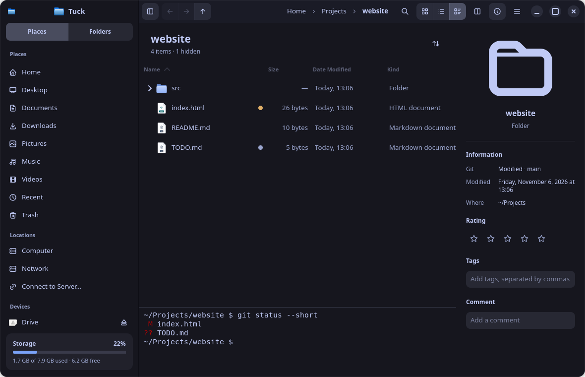
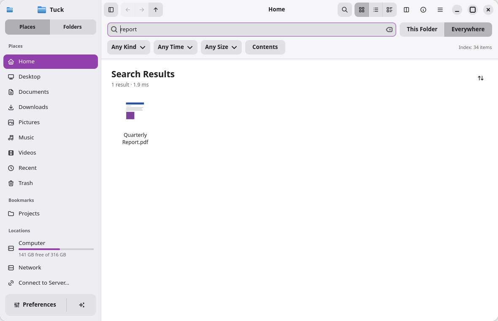
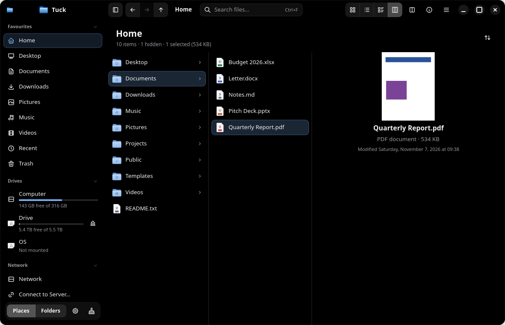
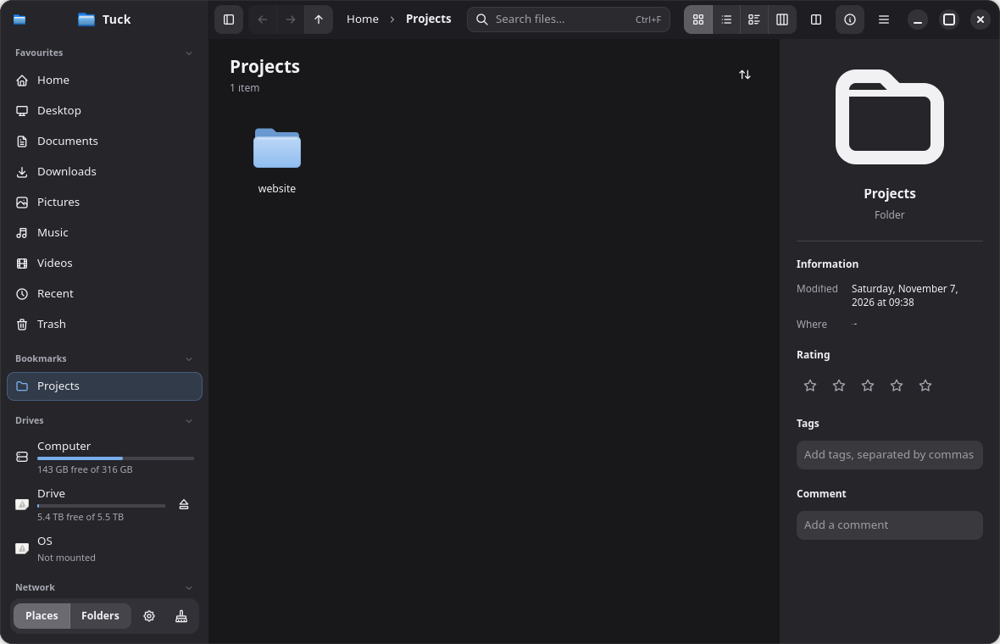
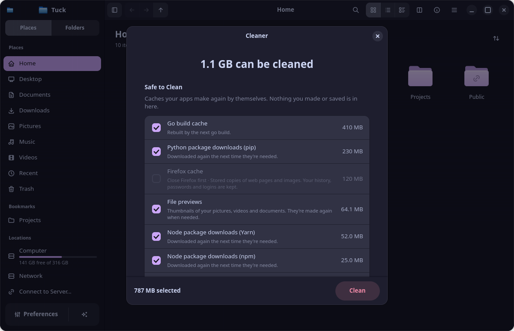
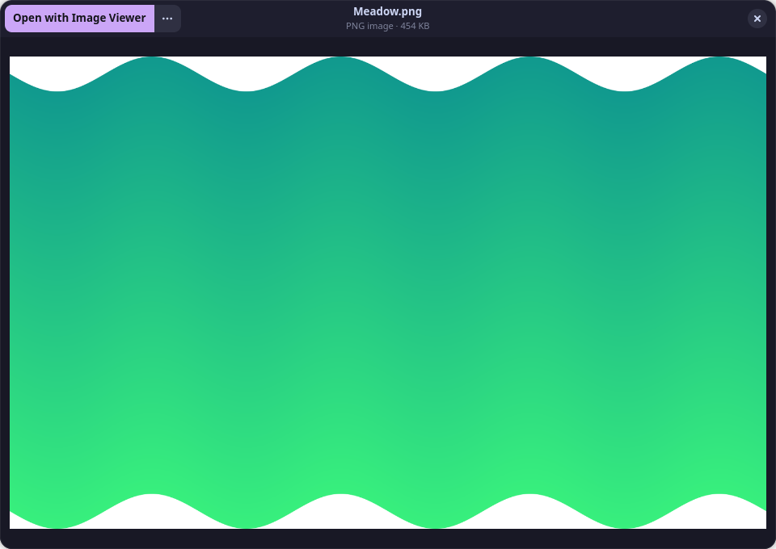
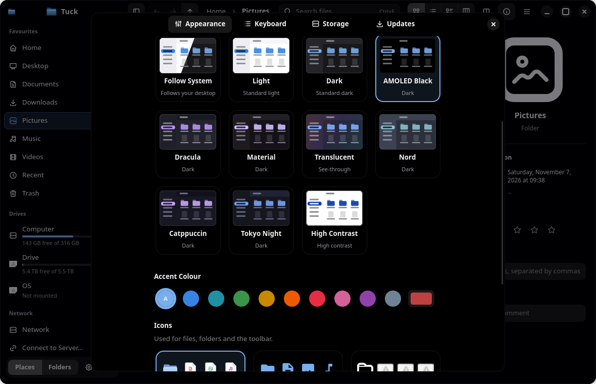

<div align="center">


# Tuck

**A fast, friendly file manager for Linux.**<br>
Dolphin's power with a calm, simple design: Quick Look, instant search, one-click archives and app installs built in.

[](https://github.com/anuzdhk/kivo-filemanager/stargazers)
[](https://github.com/anuzdhk/kivo-filemanager/watchers)
[](https://github.com/anuzdhk/kivo-filemanager/forks)
[](https://hits.sh/github.com/anuzdhk/kivo-filemanager/)
<br>
[](https://github.com/anuzdhk/kivo-filemanager/releases/latest)
[](https://github.com/anuzdhk/kivo-filemanager/actions/workflows/ci.yml)
[](LICENSE)

[Install](#install) · [Features](#features) · [Screenshots](#screenshots) · [Shortcuts](#keyboard-shortcuts) · [Themes](#themes) · [Build](#build-from-source)



</div>

---

## Install

**One command** (Debian, Ubuntu, Fedora, openSUSE, Arch, and everything else via AppImage):

```bash
curl -fsSL https://raw.githubusercontent.com/anuzdhk/kivo-filemanager/feat/strata/get.sh | sh
```

It picks the right package for your system, checks it against the release's SHA-256 checksums, and installs it. It asks for your password through `sudo`, except for the AppImage, which installs just for you. Want to see what it would do first?

```bash
curl -fsSL https://raw.githubusercontent.com/anuzdhk/kivo-filemanager/feat/strata/get.sh | sh -s -- --dry-run
```

Use `sh -s -- --appimage` to get the AppImage on any system.

### Or download a package

Grab the file for your system from the [latest release](https://github.com/anuzdhk/kivo-filemanager/releases/latest):

| Your system | File | Install it with |
|---|---|---|
| Debian 13+, Ubuntu 25.04+, Linux Mint, Pop!_OS… | `tuck_<version>_amd64.deb` | `sudo apt install ./tuck_*.deb` |
| Fedora 41+ | `tuck-<version>.x86_64.rpm` | `sudo dnf install ./tuck-*.x86_64.rpm` |
| openSUSE Tumbleweed | `tuck-<version>.x86_64.rpm` | `sudo zypper install ./tuck-*.x86_64.rpm` |
| Arch, EndeavourOS, Manjaro… | `tuck-<version>-x86_64.pkg.tar.zst` | `sudo pacman -U ./tuck-*.pkg.tar.zst` |
| Anything else | `Tuck-<version>-x86_64.AppImage` | `chmod +x Tuck-*.AppImage`, then run it |

> [!NOTE]
> Tuck needs **GTK 4.16** and **libadwaita 1.6** or newer. Ubuntu 24.04 LTS and older ship older versions, so they aren't supported yet.

### After installing

- **Make Tuck your file manager:** Preferences › Updates › **Make Default**. Folders from your browser, desktop and other apps then open in Tuck.
- **Stay up to date:** Preferences › Updates › **Check Now** (or turn on **Check Automatically**). Tuck downloads the right package, verifies it, and installs it when you say so.
- **Uninstall:** remove it the way you installed it, e.g. `sudo apt remove tuck`, `sudo dnf remove tuck`, `sudo pacman -R tuck`, or delete `~/Applications/Tuck.AppImage`.

---

## Features

**Browse your way**
- Icons, compact, details and **column** views (macOS-style columns that build up as you go deeper, Ctrl+4), tabs, and split view (F3)
- A folder tree (F7), a built-in terminal that follows you (F4), and an Information panel (F11)
- Live updates, type-ahead, a filter bar, selection mode, per-folder view settings, and session restore

**Find things fast**
- Instant search across your home folder, including inside documents and code (Ctrl+F)
- Filters for kind, date and size, or type them: `kind:pdf`, `modified:week`, `size:>10mb`, `tag:work`

**Preview without opening**
- Press **Space** for Quick Look: images, video, audio, PDFs, code with syntax colours, Markdown, and archive contents
- Arrow keys move to the next file while the preview stays open

**Archives and apps, one click away**
- Double-click a `.zip`, `.tar.gz`, `.7z`, `.rar`… to extract it safely next to itself; password-protected archives too
- Right-click › Compress to make ZIP, tar or 7z archives, with optional encryption
- Double-click a `.deb`, `.rpm`, `.flatpakref` or AppImage to install it

**Organise**
- Tags, star ratings and comments, shared with Dolphin; find everything with a tag from the sidebar
- Git status dots on changed files
- Undo and redo for every file operation; nothing is ever deleted by an undo
- Bookmarks, network shares (SFTP, SMB, FTP, WebDAV), mounting and ejecting drives
- **Cleaner**: free space by clearing caches that are safe to delete (previews, browser and package caches); it never touches your files, and skips a browser's cache while it's open
- See how full each drive is right in the sidebar, with details in Preferences › Storage

**Make it yours**
- 11 themes (including AMOLED Black) plus your own, any accent colour, text that always stays readable
- Tuck, Material, or your **system's own icon theme**
- Every keyboard shortcut can be changed, and Dolphin's service menus work in Tuck

---

## Screenshots

<table>
  <tr>
    <td width="50%"><br><sub><b>Details view</b> with git status dots and the built-in terminal (Tokyo Night theme)</sub></td>
    <td width="50%"><br><sub><b>Search</b> results as you type, with kind, date and size filters</sub></td>
  </tr>
  <tr>
    <td width="50%"><br><sub><b>Column view</b>: each folder opens in the next column, with a preview at the end (AMOLED Black theme)</sub></td>
    <td width="50%"><br><sub><b>Sidebar</b>: foldable sections, and how full each drive is</sub></td>
  </tr>
  <tr>
    <td width="50%"><br><sub><b>Cleaner</b>: free space from caches that are safe to delete (Catppuccin theme)</sub></td>
    <td width="50%"><br><sub><b>Quick Look</b>: press Space to preview, arrows for the next file</sub></td>
  </tr>
  <tr>
    <td colspan="2"><br><sub><b>Preferences</b>: pick one of 11 themes from live previews, any accent colour, or add your own theme</sub></td>
  </tr>
</table>

---

## Keyboard shortcuts

| Action | Keys |
|---|---|
| Quick Look | <kbd>Space</kbd> |
| Search | <kbd>Ctrl</kbd>+<kbd>F</kbd> |
| New tab / close tab / reopen closed tab | <kbd>Ctrl</kbd>+<kbd>T</kbd> / <kbd>Ctrl</kbd>+<kbd>W</kbd> / <kbd>Ctrl</kbd>+<kbd>Shift</kbd>+<kbd>T</kbd> |
| Icons / Compact / Details / Columns | <kbd>Ctrl</kbd>+<kbd>1</kbd> … <kbd>Ctrl</kbd>+<kbd>4</kbd> |
| Split view | <kbd>F3</kbd> |
| Terminal / folder tree / information panel | <kbd>F4</kbd> / <kbd>F7</kbd> / <kbd>F11</kbd> |
| Go to a location | <kbd>Ctrl</kbd>+<kbd>L</kbd> |
| Rename | <kbd>F2</kbd> |
| Move to Trash / delete permanently | <kbd>Delete</kbd> / <kbd>Shift</kbd>+<kbd>Delete</kbd> |
| Undo / redo | <kbd>Ctrl</kbd>+<kbd>Z</kbd> / <kbd>Ctrl</kbd>+<kbd>Shift</kbd>+<kbd>Z</kbd> |
| Show hidden files | <kbd>Ctrl</kbd>+<kbd>H</kbd> |
| Add folder to Places | <kbd>Ctrl</kbd>+<kbd>B</kbd> |
| Preferences | <kbd>Ctrl</kbd>+<kbd>,</kbd> |
| All shortcuts | <kbd>Ctrl</kbd>+<kbd>?</kbd> |

Change any of them in **Preferences › Keyboard**.

---

## Themes

Open **Preferences** (<kbd>Ctrl</kbd>+<kbd>,</kbd>) to pick a theme from the gallery, an accent colour, an icon style and the text size. Tuck adjusts colours automatically so text always stays readable (WCAG AA), whatever you choose.

**Make your own:** put a `.toml` file in `~/.config/tuck/themes/`, then press **Reload Themes**. It appears in the gallery.

```toml
name = "Solarized Dark"
dark = true
[colors]
window_bg = "#002b36"
window_fg = "#93a1a1"
sidebar_bg = "#073642"   # optional, like every key below
dim_fg = "#839496"
accent = "#268bd2"
```

---

## Build from source

You need Rust (stable) and the development files for GTK 4.16+ and libadwaita 1.6+.

<details>
<summary><b>Debian / Ubuntu</b></summary>

```bash
sudo apt install build-essential pkg-config libgtk-4-dev libadwaita-1-dev libgtksourceview-5-dev libpoppler-glib-dev libarchive-dev libvte-2.91-gtk4-dev gstreamer1.0-plugins-good
```
</details>

<details>
<summary><b>Fedora</b></summary>

```bash
sudo dnf install gcc pkgconf-pkg-config gtk4-devel libadwaita-devel gtksourceview5-devel poppler-glib-devel libarchive-devel vte291-gtk4-devel
```
</details>

<details>
<summary><b>Arch</b></summary>

```bash
sudo pacman -S base-devel gtk4 libadwaita gtksourceview5 poppler-glib libarchive vte4
```
</details>

Then build, run, and install:

```bash
git clone https://github.com/anuzdhk/kivo-filemanager.git && cd kivo-filemanager
cargo build --release
./target/release/tuck            # run it from here, or install it:
./install.sh --user              # just for you, no sudo (sudo ./install.sh for everyone)
./install.sh --user --uninstall  # remove it again
```

How each package is built and how releases are made: [packaging/README.md](packaging/README.md).

---

## For developers

<details>
<summary><b>Project layout</b></summary>

- `crates/tuck-core`: UI-free logic (files, archives, search, themes, updates, …) with its own tests
- `crates/tuck`: the GTK 4 / libadwaita app
- `data/`: desktop entry, AppStream metadata and icons
- `packaging/`: `.deb`, RPM, AppImage and Arch packaging, version scripts
- `docs/`: [Dolphin parity checklist](docs/PARITY.md) (what works and what's untested), [plan](docs/PLAN.md), [benchmarks](docs/BENCHMARKS.md)

Tests: `cargo test --workspace`. Lints: `cargo clippy --workspace --all-targets`.

To add a built-in theme, add its TOML to `BUILTIN` and its name to `CHOICES` in `crates/tuck-core/src/theme.rs`. The gallery and the readability checks pick it up from there.
</details>

<details>
<summary><b>Scripting and test hooks</b></summary>

The app can be driven from scripts for smoke tests and screenshots:

```bash
TUCK_ACTIONS="win.view-mode::details;win.split" TUCK_SCREENSHOT=/tmp/shot.png ./target/release/tuck ~/
```

`TUCK_ACTIONS` runs window/app actions in order (see `crates/tuck/src/debug.rs` for the other steps). `TUCK_SCREENSHOT` renders the window to PNG and then closes it, on Wayland and X11. Scripted runs start their own instance and never touch a Tuck you have open. `TUCK_DEBUG_TIMING=1` prints listing timings; `TUCK_DEBUG_KEYS=1` logs keyboard focus.
</details>

<details>
<summary><b>Coming from Kivo?</b></summary>

Tuck was called Kivo during development. On first start it moves Kivo's settings, session and caches (`~/.config/kivo`, `~/.local/state/kivo`, `~/.cache/kivo`) to the new `tuck` folders.
</details>

---

## Credits and license

Tuck is free software under the **GPL-3.0-or-later** licence (see [LICENSE](LICENSE)).

- App installation is ported from [Teku](https://github.com/anuzdhk/teku) (GPL-3.0-or-later): file-type and distro detection, install routes and commands, AppImage menu entries (kept compatible), messages and history format. See `crates/tuck-core/src/install/`.
- UI icons: [Tabler Icons](https://github.com/tabler/tabler-icons) (MIT, `LICENSES/tabler-icons-MIT.txt`) and [Material Symbols](https://github.com/google/material-design-icons) (Apache-2.0, `LICENSES/material-symbols-Apache-2.0.txt`). Tuck's app icon and its folder and document icons are original artwork. See `data/icons/README.md`.
- `crates/tuck-core/tests/fixtures/tree.rar` comes from the compress-tools crate (MIT OR Apache-2.0).
- RAR extraction uses the system libarchive (BSD-2-Clause). Password-protected RAR uses the system `unrar` if present; it isn't bundled.

<div align="center">

If Tuck is useful to you, a ⭐ helps other people find it.

</div>
