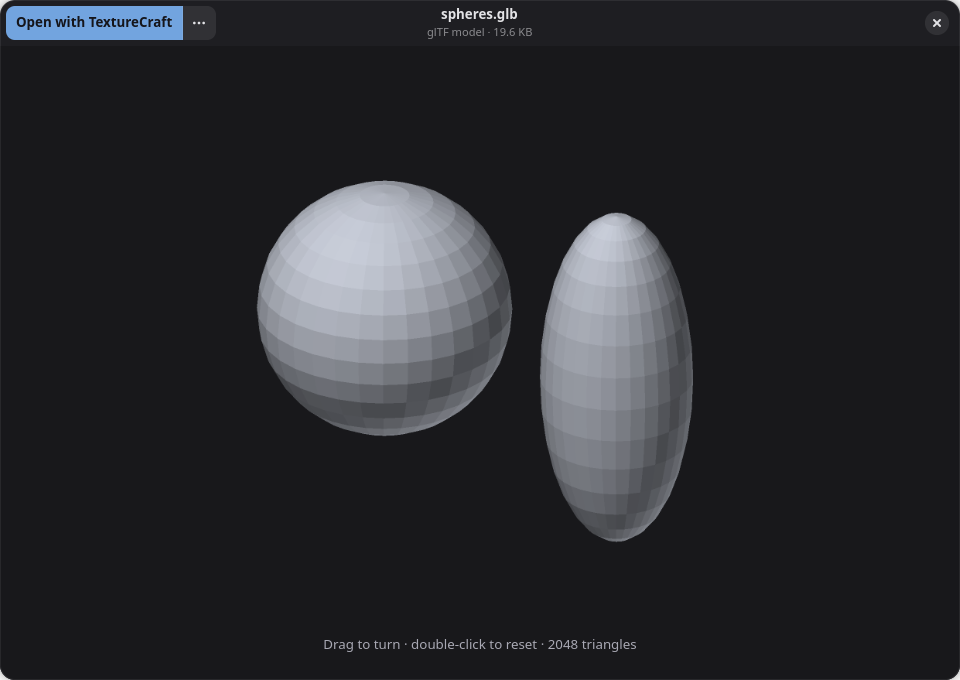
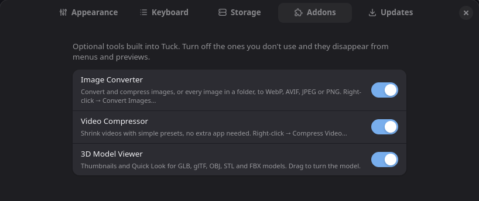

## Tuck 0.1.4

### New: Addons

Optional tools built into Tuck, each with its own switch in **Preferences › Addons**. Turn off the ones you don't use and they disappear from menus and previews.

- **Image Converter:** right-click images, or a whole folder, then **Convert Images…** Choose WebP, AVIF, JPEG or PNG, the quality (70 by default) and optionally a maximum size. New files are saved next to the originals, which are never changed, and Tuck tells you how much space you saved. Uses ImageMagick.
- **Video Compressor:** right-click a video, then **Compress Video…** Pick High quality, Balanced or Smallest file, and optionally 1080p, 720p or 480p. It saves an MP4 that plays everywhere, with progress in the header and a Cancel button. Uses FFmpeg.
- **3D Model Viewer:** thumbnails and Quick Look (Space) for GLB, glTF, OBJ, STL and binary FBX models. Drag to turn the model; double-click to reset. Built in, with nothing to install.





If ImageMagick or FFmpeg isn't installed, the Addons page says which package to install.

### Improved

- **Search results take less room:** the big "Search Results" heading is gone. The result count and time now sit on the filter row, so results start right below the filters.
- **Open With** is now a submenu that opens beside the menu and lists your usual apps, with "Other Application…" at the bottom. Other submenus open beside the menu too.
- **AppImage runs on older systems:** it now carries its own copy of the C library, so it starts on distributions as old as Ubuntu 22.04. Drives, the Trash and network shares work as in the packages, and it's still about 45 MB.

### Fixed

- **Column view:** you can drag and drop between columns, onto a folder or onto the empty space of a column.
- **The search field in the header** comes back when you go from a long path to a short one, and the Home crumb no longer hides when Tuck starts inside a subfolder.
- **Compact and Details view buttons** no longer look the same with some icon themes (e.g. MacTahoe).

### Install or update

```bash
curl -fsSL https://raw.githubusercontent.com/anuzdhk/tuck-filemanager/feat/strata/get.sh | sh
```

Already have Tuck? Open **Preferences › Updates › Check Now**. Packages below: `.deb` (Debian 13+, Ubuntu 25.04+), `.rpm` (Fedora 41+, openSUSE Tumbleweed), Arch, and an AppImage for everything else. Every file is listed in `SHA256SUMS`.

Enjoying Tuck? You can support it on [Ko-fi](https://ko-fi.com/anujdhakal).
