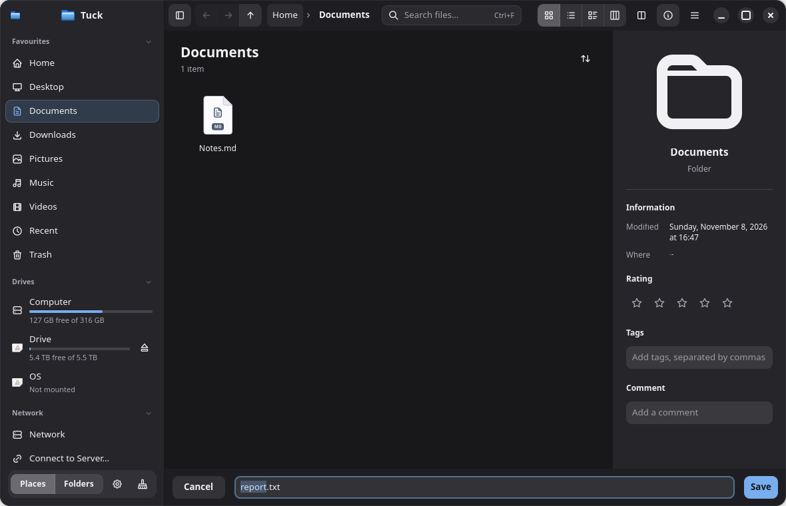
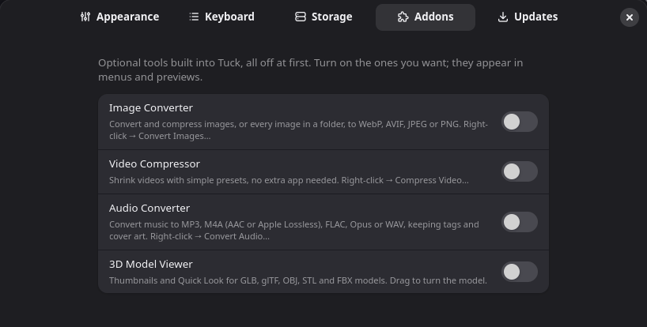

## Tuck 0.1.5

### New

- **Pick files with Tuck:** other apps' Open and Save dialogs can now be Tuck windows, with a bar along the bottom for Cancel, the file name and Open or Save. Turn it on in **Preferences › Updates › Pick Files With Tuck**. It works through the desktop's file chooser portal and changes only the file picker setting; turning it off puts your old dialogs back. It needs the .deb, .rpm or Arch package (the AppImage can't register it). For now every file shows, whatever file types the app asks for. ([#3](https://github.com/anuzdhk/tuck-filemanager/issues/3))
- **Audio Converter addon:** right-click music, or a folder of it, then **Convert Audio…** Convert to MP3, M4A (AAC or Apple Lossless), FLAC, Opus or WAV, with 128–320 kbit/s for MP3, AAC and Opus. Tags and cover art are kept, and the originals are never changed. Uses FFmpeg. ([#2](https://github.com/anuzdhk/tuck-filemanager/issues/2))
- **Update notifications:** when a new version is out, you get a desktop notification with an **Update** button. Checking is now on by default for new installs. Once a day, Tuck asks GitHub for the latest version number, and nothing is downloaded without asking.
- **Drop files on the terminal** (F4) to type their paths, quoted for the shell.



### Changed

- **Addons start off.** Turn on the ones you want in **Preferences › Addons**: Image Converter, Video Compressor, Audio Converter and 3D Model Viewer. If you already switched one on or off, that choice stays.



### Fixed

- **Dragging files** that are already selected no longer turns into a selection box that changes the selection. A quick press-and-drag on a file now always drags it; the selection box starts only on empty space.

### Thanks

Thanks to Rawi Rai (u/rawirai) for feedback and ideas, and to everyone who opened issues.

### Install or update

```bash
curl -fsSL https://raw.githubusercontent.com/anuzdhk/tuck-filemanager/feat/strata/get.sh | sh
```

Already have Tuck? Open **Preferences › Updates › Check Now**. Packages below: `.deb` (Debian 13+, Ubuntu 25.04+), `.rpm` (Fedora 41+, openSUSE Tumbleweed), Arch, and an AppImage for everything else. Every file is listed in `SHA256SUMS`.

Enjoying Tuck? You can support it on [Ko-fi](https://ko-fi.com/anujdhakal).
